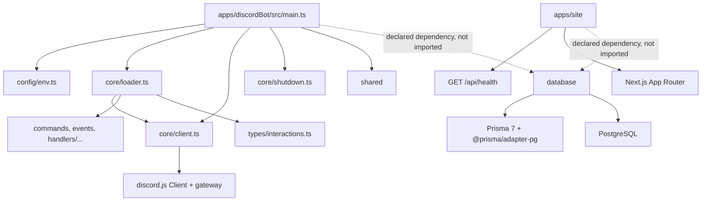

# Architecture

This document describes how the Veyra repository is organized, what each workspace
package does, and how the pieces connect at runtime. It is a description of the code
that exists today. The target product and its planned features are in the root
[README.md](../README.md) and [ROADMAP.md](../ROADMAP.md); most of those features are
not implemented yet.

For the public surface of each module, see [Modules and API reference](./modules.md).
For the database tables, see [Data model and storage](./data-model.md). For environment
variables and build/tool configuration, see [Configuration](./configuration.md).

## Repository shape

Veyra is a pnpm workspace (`pnpm-workspace.yaml`). Four packages are defined:

| Workspace directory | Package name | Role | Current state |
| --- | --- | --- | --- |
| `apps/discordBot` | `discord-bot` | Official Discord bot | Runnable skeleton: env validation, module auto-loading, login, graceful shutdown |
| `apps/site` | `site` | Official website | Next.js 16 scaffold: placeholder landing page and a health endpoint |
| `shared` | `shared` | Cross-package utilities | Winston logger facade, imported by the bot as `import { logger } from "shared"` |
| `database` | `database` | Prisma data layer | Generated client plus PostgreSQL driver adapter; not imported by any application |

Both applications declare `database` as a workspace dependency, and the bot also
declares `shared`. No application imports `database` yet. There are no other
workspace packages.

Supporting directories at the repository root:

| Directory | Purpose |
| --- | --- |
| `tests/` | Root-level Vitest suite and loader fixture modules |
| `schemas/` | Machine-readable JSON Schema for the `veyra.json` submission manifest |
| `docs/` | All project documentation (this directory) |
| `catalog/` | Placeholder for catalog data and assets; currently only `.gitkeep` |
| `.github/workflows/` | CI workflow |
| `.husky/` | Git hook scripts |
| `nginx/` | Reverse-proxy image and configuration for the compose stack |
| `ssl/` | TLS certificate directory and its README |

## Component map

The dashed edges are dependency declarations without any application import: the
`database` package is wired into the workspace but is not used by the bot or the
site at runtime.

## Bot startup and runtime flow

1. `apps/discordBot/src/main.ts` imports the `ENV` snapshot. If `ENV.clientId` or
   `ENV.token` is missing, it logs an error, starts `shutdown()` without awaiting it,
   and calls `process.exit(1)`.
2. With credentials present, `Loaders().LoadAll()` runs. It scans five directories
   under the bot's `src/` tree in a fixed order: `handlers/buttons`, `commands`,
   `events`, `handlers/menus`, `handlers/modals`. Each existing directory is walked
   recursively; files ending in `.ts` or `.js` are dynamically imported.
3. Each imported module is validated by the matching loader and either stored in one
   of the four `dsClient` collections (`commands`, `buttons`, `menus`, `modals`) or,
   for events, subscribed with `client.on` / `client.once`. Invalid modules are logged
   and skipped rather than crashing the process.
4. `dsClient.login(ENV.token)` connects to Discord. Failures (for example, a
   disabled privileged intent) are logged by the boot `try`/`catch`; the process is
   not rethrown.
5. `SIGINT` and `SIGTERM` call `shutdown()`, which destroys the shared client.
   `SIGTERM` also sets `process.exitCode = 1`.

Two important limits of the current skeleton:

- The interaction directories (`src/commands`, `src/events`, and
  `src/handlers/{buttons,menus,modals}`) do not exist in the repository. On a fresh
  boot the loader logs a warning for each missing path and reports zero loaded
  modules.
- There is no `interactionCreate` listener and no REST application-command
  registration. Loaded handlers are only stored in in-memory collections; they never
  reach Discord until a dispatcher and registration step are added.

## Website runtime flow

`apps/site` is a Next.js 16 App Router application. `src/app/layout.tsx` provides the
root layout (metadata, Geist font CSS variables, global stylesheet), and
`src/app/page.tsx` renders a placeholder "Hello World" landing page at `/`. The only
API route is `src/app/api/health/route.ts`, whose `GET` handler returns
`Response.json({ ok: true })`. This endpoint is used by the compose healthcheck for
the `site` service.

The Next.js configuration enables `cacheComponents`, `partialPrefetching`, and a
Turbopack rule that processes `*.css` with `@tailwindcss/turbopack`.

## Shared utilities

`shared/src/index.ts` re-exports a single `logger` facade implemented with Winston.
The logger is configured at import time with a coloured console transport and a
daily-rotating file transport. Log files are written to `logs/app-<date>.log` under
the process working directory; the file transport accepts `warn` and `error`
records and keeps seven days of history. `debug` messages are emitted only when the
module was imported with `NODE_ENV=development`.

## Data layer flow

`database/src/index.ts` re-exports the generated `@prisma/client` surface and
`PrismaPg`. The client singleton lives in a separate module,
`database/src/setup.ts`, which reads `DATABASE_CONNECTION_STRING`, builds a
`PrismaPg` adapter, and constructs `PrismaClient`. That module throws at import time
when the connection string is missing or empty. The Prisma CLI configured in
`prisma.config.ts` uses the same variable from `database/.env` when run through the
package scripts. See [Configuration](./configuration.md#database-variables-in-detail) and
[Data model and storage](./data-model.md).

## Deployment topology

`docker-compose.yaml` defines four services on the `veyra-net` bridge network:
`db` (PostgreSQL 18), `site`, `nginx` (reverse proxy), and `discord-bot`. Builds for
the two applications use the repository root as context and their own Dockerfiles;
both images compile in a `node:24-alpine` build stage and deploy production
dependencies into a `node:24-alpine` runtime stage without baking in `.env` files.

Earlier blockers were fixed: both application Dockerfiles now copy the `database`
workspace manifest, nginx defines `$connection_upgrade` in an active `map`, and the
bot has no healthcheck because it exposes no HTTP server. HTTPS is still disabled, so
port 443 has no listener and the mounted `ssl/` files are not read yet. See
[Development workflow](./development.md#docker) for the full analysis and stack
commands, and [Deployment and operations](./deployment.md) for the container details.

## Relationship to the product plan

The distribution wizard, catalog, accounts, submissions, tickets, reviews, private
testing, and the 72-hour download flow are described in the root README and the
roadmap. None of them is implemented in application code today. The only contract
that has been materialized for those future features is the `veyra.json` manifest:
its [specification](./specifications/bot-metadata.md) and
[JSON Schema](../schemas/bot-metadata.schema.json). There is no submission or
validation code that consumes the schema yet.

## Related documents

- [Modules and API reference](./modules.md)
- [Data model and storage](./data-model.md)
- [Configuration](./configuration.md)
- [Development workflow](./development.md)
- [Testing](./testing.md)
- [Deployment and operations](./deployment.md)
- [Documentation index](./README.md)
