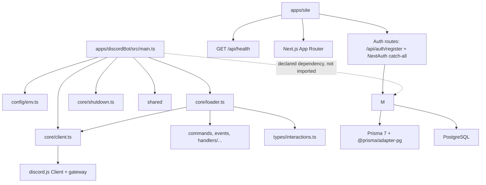

# Architecture

This document describes how the Veyra repository is organized, what each workspace
package does, and how the pieces connect at runtime. It is a description of the code
that exists today. The target product and its planned features are in the root
[README.md](../README.md) and [ROADMAP.md](../ROADMAP.md); most of those features are
not implemented yet.

For the public surface of each module, see [Modules and API reference](./modules.md).
For the database tables, see [Data model and storage](./data-model.md). For environment
variables and build/tool configuration, see [Configuration](./configuration.md).

## Repository shape

Veyra is a pnpm workspace (`pnpm-workspace.yaml`). Four packages are defined:

| Workspace directory | Package name | Role | Current state |
| --- | --- | --- | --- |
| `apps/discordBot` | `discord-bot` | Official Discord bot | Runnable skeleton: env validation, module auto-loading, login, graceful shutdown |
| `apps/site` | `site` | Official website | Next.js 16 app: placeholder landing page, sign-in/register screens, auth API routes and a health endpoint |
| `shared` | `shared` | Cross-package utilities | Winston logger facade, imported by the bot as `import { logger } from "shared"` |
| `database` | `database` | Prisma data layer | Generated client, PostgreSQL driver adapter and lazy `prisma` singleton; imported by the site |

Both applications declare `database` and `shared` as workspace dependencies. The
site imports `database` from its registration route, its NextAuth catch-all route
and its auth service; the bot declares the dependency but does not import it.
There are no other workspace packages.

Supporting directories at the repository root:

| Directory | Purpose |
| --- | --- |
| `tests/` | Root-level Vitest suite and loader fixture modules |
| `schemas/` | Machine-readable JSON Schema for the `veyra.json` submission manifest |
| `docs/` | All project documentation (this directory) |
| `catalog/` | Placeholder for catalog data and assets; currently only `.gitkeep` |
| `.github/workflows/` | CI workflow |
| `.husky/` | Git hook scripts |
| `nginx/` | Reverse-proxy image and configuration for the compose stack |
| `ssl/` | TLS certificate directory and its README |

## Component map

The dashed edge is a dependency declaration without an application import: the bot
declares `database` but does not use it. The site imports the package from its
registration route, NextAuth catch-all route and auth service (solid edges).

## Bot startup and runtime flow

1. `apps/discordBot/src/main.ts` imports the `ENV` snapshot. If `ENV.clientId` or
   `ENV.token` is missing, it logs an error, starts `shutdown()` without awaiting it,
   and calls `process.exit(1)`.
2. With credentials present, `Loaders().LoadAll()` runs. It scans five directories
   under the bot's `src/` tree in a fixed order: `handlers/buttons`, `commands`,
   `events`, `handlers/menus`, `handlers/modals`. Each existing directory is walked
   recursively; files ending in `.ts` or `.js` are dynamically imported.
3. Each imported module is validated by the matching loader and either stored in one
   of the four `dsClient` collections (`commands`, `buttons`, `menus`, `modals`) or,
   for events, subscribed with `client.on` / `client.once`. Invalid modules are logged
   and skipped rather than crashing the process. The `src/events/interactionCreate.ts`
   module subscribes the central dispatcher to incoming interactions.
4. `registerCommands()` publishes the JSON of the loaded slash commands through
   Discord's REST API. A failure is logged and does not block the gateway login.
5. `dsClient.login(ENV.token)` connects to Discord. Failures (for example, a
   disabled privileged intent) are logged by the boot `try`/`catch`; the process is
   not rethrown.
6. `SIGINT` and `SIGTERM` call `shutdown()`, which destroys the shared client.
   `SIGTERM` also sets `process.exitCode = 1`.

One limit remains in the current skeleton: the interaction directories
(`src/commands` and `src/handlers/{buttons,menus,modals}`) do not exist in the
repository, so a fresh boot warns about those four paths and loads no user-facing
handlers. The event directory now exists with the dispatcher bridge, and the
dispatcher plus REST registration mean any module added to those directories is
reachable from Discord.

## Website runtime flow

`apps/site` is a Next.js 16 App Router application. `src/app/layout.tsx` provides the
root layout (metadata, Geist font CSS variables, global stylesheet), and
`src/app/page.tsx` renders a placeholder landing page at `/` with a Sign In button. Two
additional App Router pages, `/signin` and `/register`, mount client forms built
from shared components in `src/components/` and the path constants in
`src/lib/routes.ts`. The forms validate locally; the sign-in form offers the
existing credentials login plus "Continue with GitHub/Google/Discord" buttons that
start a NextAuth redirect to `/api/auth/callback/<provider>` and return to `/`.
`/signin` also renders generic messages for `?error=` codes. Two more account
screens exist: `/signout` calls `signOut()` from `next-auth/react`, and `/account`
lists the user's linked OAuth providers and lets them unlink one through
`/api/account/providers`, which identifies the user from the JWT cookie and
protects the last sign-in method. `src/lib/authConfig.ts` owns the server-side
provider registration, scopes and session policy; the `[...nextauth]` route wires
it to the Prisma adapter. `src/app/api/health/route.ts` returns
`Response.json({ ok: true })` and is used by the compose healthcheck for the
`site` service.

The Next.js configuration enables `cacheComponents`, `partialPrefetching`, and a
Turbopack rule that processes `*.css` with `@tailwindcss/turbopack`, excluding
`*.module.css` so CSS Modules keep Next's generated class-name mapping.

## Shared utilities

`shared/src/index.ts` re-exports a single `logger` facade implemented with Winston.
The logger is configured at import time with a coloured console transport and a
daily-rotating file transport. Log files are written to `logs/app-<date>.log` under
the process working directory; the file transport accepts `warn` and `error`
records and keeps seven days of history. `debug` messages are emitted only when the
module was imported with `NODE_ENV=development`.

## Data layer flow

`database/src/index.ts` re-exports the generated `@prisma/client` surface,
`PrismaPg` and the `prisma` singleton. The singleton lives in a separate module,
`database/src/setup.ts`, and is lazily initialized: on the first property access
it reads `DATABASE_CONNECTION_STRING`, builds a `PrismaPg` adapter, and constructs
one `PrismaClient`. Importing the barrel has no such side effects, so Next.js can
evaluate route modules during `next build` without runtime credentials; the guard
throws on first use when the connection string is missing or empty. The Prisma CLI configured in
`prisma.config.ts` uses the same variable from `database/.env` when run through the
package scripts. See [Configuration](./configuration.md#database-variables-in-detail) and
[Data model and storage](./data-model.md).

## Deployment topology

`docker-compose.yaml` defines four services on the `veyra-net` bridge network:
`db` (PostgreSQL 18), `site`, `nginx` (reverse proxy), and `discord-bot`. Builds for
the two applications use the repository root as context and their own Dockerfiles;
both images compile in a `node:24-alpine` build stage and deploy production
dependencies into a `node:24-alpine` runtime stage without baking in `.env` files.
The site image also carries the brand token stylesheet imported by `globals.css`;
both images build `shared` and `database` first and restore the generated Prisma
client after `pnpm deploy` (the site restores Turbopack's hashed externals too).

Earlier blockers were fixed: both application Dockerfiles now copy the workspace
sources, nginx defines `$connection_upgrade` in an active `map`, and the bot has no
healthcheck because it exposes no HTTP server. HTTPS is still disabled, so
port 443 has no listener and the mounted `ssl/` files are not read yet. See
[Development workflow](./development.md#docker) for the full analysis and stack
commands, and [Deployment and operations](./deployment.md) for the container details.

## Relationship to the product plan

The distribution wizard, catalog, submissions, tickets, reviews, private testing,
and the 72-hour download flow are described in the root README and the roadmap.
None of them is implemented in application code today. Account registration and
sign-in are implemented in `apps/site`; see [Internal API notes](./api_documentation.md).
The only contract
that has been materialized for those future features is the `veyra.json` manifest:
its [specification](./specifications/bot-metadata.md) and
[JSON Schema](../schemas/bot-metadata.schema.json). There is no submission or
validation code that consumes the schema yet.

## Related documents

- [Modules and API reference](./modules.md)
- [Data model and storage](./data-model.md)
- [Configuration](./configuration.md)
- [Development workflow](./development.md)
- [Testing](./testing.md)
- [Deployment and operations](./deployment.md)
- [Documentation index](./README.md)
