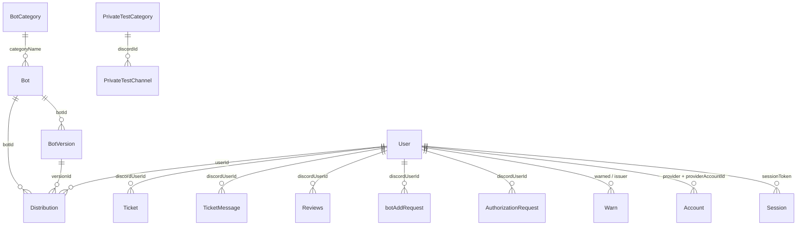

# Data model and storage

This document describes the Prisma schema, the generated client, and how the data
layer is intended to be used. The schema is split across
`database/prisma/schema/*.prisma` files and applied through six SQL migrations in
`database/prisma/migrations/`.

**Current status:** the site reads and writes `User` rows through
`apps/site/src/services/auth.ts` (registration and credentials login), while the
NextAuth handler in `apps/site/src/app/api/auth/[...nextauth]/route.ts` uses the
Prisma adapter for `Account`, `Session` and `VerificationToken`-shaped data. The
remaining models describe the planned features in [ROADMAP.md](../ROADMAP.md) and
are not used by application code today. JWT sessions are enabled, so the `Session`
table is not written by the running site.

## Connection and client construction

The datasource provider is `postgresql`. `schema.prisma` declares no `url`; the URL
is supplied by `database/prisma.config.ts` from `DATABASE_CONNECTION_STRING`. The
runtime singleton in `database/src/setup.ts` builds a `PrismaPg` driver adapter from
the same variable and passes it to `PrismaClient`. See
[Configuration](./configuration.md#database-variables-in-detail).

Commands exposed by `database/package.json`:

| Command | Effect |
| --- | --- |
| `pnpm --filter database generate` | Generates the client from `prisma/` |
| `pnpm --filter database format` | Formats the Prisma schema |
| `pnpm --filter database push` | Pushes the schema to the database |
| `pnpm --filter database migrate` | Runs `prisma migrate dev` |
| `pnpm --filter database studio` | Opens Prisma Studio |

Run them through the package filter so the Prisma CLI executes with `database/` as
its working directory; a bare `prisma` invocation from the repository root finds
neither `prisma.config.ts` nor the schema.

## Entity overview

Most primary keys are `String` values generated with `cuid()`. `Warn.id` is the only
`Int` key and uses `autoincrement()`. The platform models (`User`, `BotCategory`,
`Bot`, `botAddRequest`, `AuthorizationRequest`, `PrivateTestCategory`,
`PrivateTestChannel`, `Reviews`, `Ticket`, `TicketMessage` and `Warn`) carry
`createdAt` (`@default(now())`) and `updatedAt` (`@updatedAt`) fields, as do the
new `BotVersion` and `Distribution` models. The three
NextAuth adapter models (`Account`, `Session`, `VerificationToken`) do not declare
timestamps.

## Models

### `User`

A platform user, optionally linked to a Discord account.

| Field | Type | Notes |
| --- | --- | --- |
| `id` | `String` | Primary key, `cuid()` |
| `discordId` | `String?` | Unique; stable Discord snowflake id stored as a string to avoid precision loss; `null` until a Discord sign-in links it |
| `username` | `String` | Required |
| `avatarHash` | `String?` | Optional |
| `avatarUrl` | `String?` | Optional; mirrors `image` for site display |
| `email` | `String?` | Optional; unique |
| `emailVerified` | `DateTime?` | Written by the NextAuth adapter; `null` for OAuth users |
| `image` | `String?` | Avatar URL written by the NextAuth adapter; mirrored into `avatarUrl` |
| `passwordHash` | `String?` | Argon2 hash used by the credentials provider |
| `authorizedDeveloper` | `Boolean` | Defaults to `false` |
| `role` | `UserRoles` | Defaults to `USER` |
| `createdAt`, `updatedAt` | `DateTime` | Timestamps |

Relations: `tickets`, `ticketMessages`, `reviews`, `addBotRequests`,
`AuthorizationRequests`, two named `Warn` relations (`warned_user` for warnings
issued against the user, `warned_by_user` for warnings the user issued), plus
`accounts` and `sessions` owned by the NextAuth adapter. Several other models
reference `discordId`, so the nullable link is effectively required for those
records.

Discord sign-in writes the account id from the OAuth profile into `discordId`.
The Discord `profile()` mapper keeps the id, `createAuthAdapter` forwards it into
the first `User` insert, and the `signIn` event in `buildAuthOptions` calls
`setUserDiscordId` (`src/services/auth.ts`) for returning and explicitly linked
accounts, where NextAuth reuses the row without calling `updateUser`. That helper
never inserts a user and skips the write if another row already owns the id, so
the unique index and the foreign keys pointing at the column stay intact; that
conflict is logged with both row ids instead of being silent. A failed write is
logged as well but does not interrupt an otherwise successful OAuth login.
GitHub, Google and credentials users keep `discordId` null.

### `Account`

An external OAuth identity linked to a `User`: one row per provider and provider
account id, with a composite primary key `(provider, providerAccountId)`. `userId`
references `User.id` with `ON DELETE CASCADE`. It stores the tokens NextAuth needs
(`access_token`, `refresh_token`, `id_token`, `expires_at`, `token_type`, `scope`,
`session_state`, all nullable). GitHub, Google and Discord sign-ins create or reuse
these rows. `type` is `oauth` for the three providers.

### `Session`

A database session owned by the NextAuth adapter: `sessionToken` is unique,
`userId` references `User.id` with `ON DELETE CASCADE`, and `expires` is a timestamp.
The site uses JWT sessions because the Credentials provider cannot use database
sessions, so no rows are written today; the table is kept for adapter parity.

### `VerificationToken`

Passwordless-email token store required by the adapter: `identifier`, `token`
(unique) and `expires`, with a composite unique index on `(identifier, token)`.
No email provider is registered, so the table is unused.

### `UserRoles` (enum)

`ADMIN`, `STAFF`, `AUTHORIZED_DEVELOPER`, `USER`. `ADMIN` and `STAFF` are staff roles;
`AUTHORIZED_DEVELOPER` grants publishing rights.

### `BotCategory`

Groups bots in the catalog. `name` is unique and is also the foreign key referenced
by `Bot.categoryName`. Fields: `id` (`cuid()`), `name`, `createdAt`, `updatedAt`, and
the `Bots` relation.

### `Bot`

A published catalog entry.

| Field | Type | Notes |
| --- | --- | --- |
| `id` | `String` | Primary key, `cuid()` |
| `name` | `String` | Required |
| `categoryName` | `String` | Foreign key to `BotCategory.name` |
| `version` | `String` | Denormalized mirror of the current `BotVersion.version` |
| `filePath` | `String` | Path to the artifact of the currently published version |
| `createdAt`, `updatedAt` | `DateTime` | Timestamps |

The relation to `BotCategory` uses `ON DELETE RESTRICT ON UPDATE CASCADE` in the
migration. `version` is retained for existing readers of the catalog; publishing a
new release creates a `BotVersion` row and refreshes these two mirror fields.

### `BotVersion`

An immutable, independently addressable release of a catalog bot. This replaces
the single-version model with a history: a new release is a new row, so an older
version keeps its own metadata and artifact.

| Field | Type | Notes |
| --- | --- | --- |
| `id` | `String` | Primary key, `cuid()` |
| `botId` | `String` | Foreign key to `Bot.id`, `ON DELETE CASCADE` |
| `version` | `String` | Semver release identifier; unique together with `botId` |
| `filePath` | `String` | Stored artifact of this exact release |
| `changelog` | `String?` | Optional release notes |
| `createdAt`, `updatedAt` | `DateTime` | Timestamps |

The `@@unique([botId, version])` constraint prevents publishing the same version
twice for one bot. Distributions reference a `BotVersion` with `ON DELETE RESTRICT`,
so a release that was handed to users cannot be removed silently.

### `Distribution`

A generated package delivered to one user from one specific bot version. This is
the storage half of the planned distribution flow; no application code writes these
rows yet.

| Field | Type | Notes |
| --- | --- | --- |
| `id` | `String` | Primary key, `cuid()` |
| `botId` | `String` | Foreign key to `Bot.id`, `ON DELETE CASCADE` |
| `versionId` | `String` | Foreign key to `BotVersion.id`, `ON DELETE RESTRICT` |
| `userId` | `String` | Foreign key to `User.id`, `ON DELETE CASCADE` |
| `displayName` | `String?` | Non-secret name mirrored into `global_settings.json` |
| `description` | `String?` | Non-secret description mirrored into `global_settings.json` |
| `packagePath` | `String` | Location of the generated archive |
| `expiresAt` | `DateTime` | Expiry of the signed link (72 hours after generation) |
| `createdAt`, `updatedAt` | `DateTime` | Timestamps |

`userId` references `User.id`, not `discordId`: email/password users have no Discord
id but still need a distribution history. Environment values supplied by the user
are written only into the generated `.env` and are never stored here; the signed
download URL is derived on demand from `packagePath` and checked against
`expiresAt`, so no long-lived credential is kept. Indexes on `(userId, createdAt)`
and `expiresAt` support the history view and cleanup of expired packages.

### `botAddRequest`

A user's request to add a bot to the catalog. Note the lowercase model name, which
is the current Prisma identifier and is retained to avoid a rename-only migration.

| Field | Type | Notes |
| --- | --- | --- |
| `id` | `String` | Primary key, `cuid()` |
| `discordUserId` | `String` | Foreign key to `User.discordId`, `ON DELETE CASCADE` |
| `githubRepository` | `String` | Required |
| `botName` | `String` | Required |
| `version` | `String` | Required |
| `createdAt`, `updatedAt` | `DateTime` | Timestamps |

### `AuthorizationRequest`

A developer's request to be authorized to publish bots, reviewed by staff.

| Field | Type | Notes |
| --- | --- | --- |
| `id` | `String` | Primary key, `cuid()` |
| `discordUserId` | `String` | Foreign key to `User.discordId`, `ON DELETE CASCADE` |
| `githubAccount` | `String` | Required |
| `portfolioLink` | `String?` | Optional |
| `status` | `AuthorizationRequestStatus` | Defaults to `PENDING` |
| `managedByDiscordUserId` | `String?` | Staff member handling the request |
| `rejectReason` | `String?` | Reason for a rejection |
| `createdAt`, `updatedAt` | `DateTime` | Timestamps |

### `AuthorizationRequestStatus` (enum)

`PENDING`, `ACCEPTED`, `REJECT`.

### `PrivateTestCategory`

A Discord category grouping private test channels for one owner. `discordId` and
`ownerDiscordId` are both unique strings; `id` is a `cuid()` primary key. A category
has a `channels` relation to `PrivateTestChannel`.

### `PrivateTestChannel`

A channel belonging to a private test category.

| Field | Type | Notes |
| --- | --- | --- |
| `id` | `String` | Primary key, `cuid()` |
| `discordId` | `String` | Discord channel id (not unique in the schema) |
| `categoryDiscordId` | `String` | Foreign key to `PrivateTestCategory.discordId`, `ON DELETE CASCADE` |
| `createdAt`, `updatedAt` | `DateTime` | Timestamps |

### `Reviews`

A user's star rating and written review. The plural model name is the current
Prisma identifier.

| Field | Type | Notes |
| --- | --- | --- |
| `id` | `String` | Primary key, `cuid()` |
| `discordUserId` | `String` | Foreign key to `User.discordId`, `ON DELETE RESTRICT` |
| `stars` | `Int` | Required |
| `content` | `String` | Required |
| `createdAt`, `updatedAt` | `DateTime` | Timestamps |

There is no relation to `Bot`: associating reviews with catalog bots is not
implemented in the data layer.

### `Ticket`

A support ticket backed by a Discord channel.

| Field | Type | Notes |
| --- | --- | --- |
| `id` | `String` | Primary key, `cuid()` |
| `discordChannelId` | `String` | Unique; the backing Discord channel |
| `discordUserId` | `String` | Foreign key to `User.discordId`, `ON DELETE RESTRICT` |
| `type` | `TicketType` | Required |
| `reason` | `String` | Required |
| `status` | `TicketStatus` | Defaults to `PENDING` |
| `createdAt`, `updatedAt` | `DateTime` | Timestamps |
| `closedAt` | `DateTime?` | Set when the ticket is closed |

### `TicketType` (enum)

`GENERAL_SUPPORT`, `REPORT_BUG`, `REPORT_USER`, `OTHER`.

### `TicketStatus` (enum)

`PENDING`, `PROGRESS`, `CLOSED`.

### `TicketMessage`

A message posted inside a support ticket. Fields: `id` (`cuid()`),
`discordUserId` (foreign key to `User.discordId`, `ON DELETE RESTRICT`), `content`,
`createdAt`, and `updatedAt`. The model has no direct relation to `Ticket` in the
schema; messages are tied to users, not to a ticket row.

### `Warn`

A moderation warning issued by one user against another. `id` is an `Int` with
`autoincrement()`. `warnedDiscordUserId` references `User.discordId` with
`ON DELETE CASCADE`; `warnAddByDiscordUserId` references it with `ON DELETE RESTRICT`.
The two relations are named `warned_user` and `warned_by_user` to disambiguate them.
`reason`, `createdAt`, and `updatedAt` complete the model.

## Migration

Six migrations are present in `database/prisma/migrations/`:

- `20261120083712_create_initial_schema/migration.sql` creates the four enums,
  eleven tables, five unique indexes (`BotCategory.name`,
  `PrivateTestCategory.discordId`, `PrivateTestCategory.ownerDiscordId`,
  `Ticket.discordChannelId`, `User.discordId`), and the foreign keys described
  above.
- `20261124103140_add_email_and_password_to_user/migration.sql` adds the nullable
  `email` and `password` columns to `User` and a unique index on `User.email`; the
  next migration renames `password` to `passwordHash`.
- `20261126210534_add_avatar_url_and_rename_password_to_password_hash/migration.sql`
  drops `password`, adds `avatarUrl` and `passwordHash`.
- `20261126233000_add_nextauth_adapter_models/migration.sql` adds `emailVerified` and
  `image` to `User` and creates `Account`, `Session` and `VerificationToken` with
  their indexes and foreign keys. Apply it with `pnpm --filter database migrate`
  against a local database before starting the site's auth routes.
- `20261127120000_backfill_discord_id_from_accounts/migration.sql` fills
  `User.discordId` for existing users that already have a Discord `Account` row:
  `Account.providerAccountId` is the stable Discord id that NextAuth uses for
  account lookup. Users with no Discord identity keep NULL and are filled on
  their next Discord sign-in. When several Discord accounts are linked, the
  smallest id is chosen; ids already owned by another row are left untouched so
  the unique index and its foreign keys stay valid. The statement is idempotent
   and can be re-run safely.
- `20261127130000_add_distributions_and_bot_versions/migration.sql` creates
   `BotVersion` and `Distribution` with their indexes and foreign keys. It is
   purely additive: no existing table or column is changed, so current catalog
   rows remain valid and `Bot.version` keeps its meaning until a publication flow
   starts maintaining the version history.

`migration_lock.toml` records `provider = "postgresql"`.

## Known gaps in the model

- No application code writes `BotVersion` or `Distribution` rows yet: the release
  publication flow and the distribution service are still to be implemented, and
  `Bot.version`/`Bot.filePath` are not yet kept in sync automatically.
- `Reviews` has no bot relation and `TicketMessage` has no ticket relation.
- The lowercase `botAddRequest` and plural `Reviews` identifiers are historical and
  are kept to avoid rename-only migrations.
- OAuth users keep `emailVerified` null; verified-email account linking is not
  performed automatically (see [Internal API notes](./api_documentation.md)).

## Related documents

- [Architecture](./architecture.md)
- [Modules and API reference](./modules.md#database-package-database)
- [Configuration](./configuration.md#database-variables-in-detail)
- [Development workflow](./development.md)
