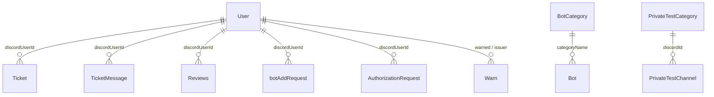

# Data model and storage

This document describes the Prisma schema, the generated client, and how the data
layer is intended to be used. The schema is split across
`database/prisma/schema/*.prisma` files and applied through the initial SQL migration
in `database/prisma/migrations/`.

**Current status:** the `database` package is a scaffold. Both applications declare
it as a workspace dependency, but no application code imports it, so none of the
models below is read or written by the bot or the site today. The data model reflects
the planned features in [ROADMAP.md](../ROADMAP.md).

## Connection and client construction

The datasource provider is `postgresql`. `schema.prisma` declares no `url`; the URL
is supplied by `database/prisma.config.ts` from `DATABASE_CONNECTION_STRING`. The
runtime singleton in `database/src/setup.ts` builds a `PrismaPg` driver adapter from
the same variable and passes it to `PrismaClient`. See
[Configuration](./configuration.md#database-variables-in-detail).

Commands exposed by `database/package.json`:

| Command | Effect |
| --- | --- |
| `pnpm --filter database generate` | Generates the client from `prisma/` |
| `pnpm --filter database format` | Formats the Prisma schema |
| `pnpm --filter database push` | Pushes the schema to the database |
| `pnpm --filter database migrate` | Runs `prisma migrate dev` |
| `pnpm --filter database studio` | Opens Prisma Studio |

Run them through the package filter so the Prisma CLI executes with `database/` as
its working directory; a bare `prisma` invocation from the repository root finds
neither `prisma.config.ts` nor the schema.

## Entity overview

Most primary keys are `String` values generated with `cuid()`. `Warn.id` is the only
`Int` key and uses `autoincrement()`. All models except `Warn` carry `createdAt`
(`@default(now())`) and `updatedAt` (`@updatedAt`) fields.

## Models

### `User`

A platform user, optionally linked to a Discord account.

| Field | Type | Notes |
| --- | --- | --- |
| `id` | `String` | Primary key, `cuid()` |
| `discordId` | `String?` | Unique; nullable until the Discord link exists |
| `username` | `String` | Required |
| `avatarHash` | `String?` | Optional |
| `authorizedDeveloper` | `Boolean` | Defaults to `false` |
| `role` | `UserRoles` | Defaults to `USER` |
| `createdAt`, `updatedAt` | `DateTime` | Timestamps |

Relations: `tickets`, `ticketMessages`, `reviews`, `addBotRequests`,
`AuthorizationRequests`, and two named `Warn` relations (`warned_user` for warnings
issued against the user, `warned_by_user` for warnings the user issued). Several
other models reference `discordId`, so the nullable link is effectively required for
those records.

### `UserRoles` (enum)

`ADMIN`, `STAFF`, `AUTHORIZED_DEVELOPER`, `USER`. `ADMIN` and `STAFF` are staff roles;
`AUTHORIZED_DEVELOPER` grants publishing rights.

### `BotCategory`

Groups bots in the catalog. `name` is unique and is also the foreign key referenced
by `Bot.categoryName`. Fields: `id` (`cuid()`), `name`, `createdAt`, `updatedAt`, and
the `Bots` relation.

### `Bot`

A published catalog entry.

| Field | Type | Notes |
| --- | --- | --- |
| `id` | `String` | Primary key, `cuid()` |
| `name` | `String` | Required |
| `categoryName` | `String` | Foreign key to `BotCategory.name` |
| `version` | `String` | Currently published version |
| `filePath` | `String` | Path to the stored distribution artifact |
| `createdAt`, `updatedAt` | `DateTime` | Timestamps |

The relation to `BotCategory` uses `ON DELETE RESTRICT ON UPDATE CASCADE` in the
migration. The schema models a single version string per bot; it does not yet model
the independent version history described in the product plan.

### `botAddRequest`

A user's request to add a bot to the catalog. Note the lowercase model name, which
is the current Prisma identifier and is retained to avoid a rename-only migration.

| Field | Type | Notes |
| --- | --- | --- |
| `id` | `String` | Primary key, `cuid()` |
| `discordUserId` | `String` | Foreign key to `User.discordId`, `ON DELETE CASCADE` |
| `githubRepository` | `String` | Required |
| `botName` | `String` | Required |
| `version` | `String` | Required |
| `createdAt`, `updatedAt` | `DateTime` | Timestamps |

### `AuthorizationRequest`

A developer's request to be authorized to publish bots, reviewed by staff.

| Field | Type | Notes |
| --- | --- | --- |
| `id` | `String` | Primary key, `cuid()` |
| `discordUserId` | `String` | Foreign key to `User.discordId`, `ON DELETE CASCADE` |
| `githubAccount` | `String` | Required |
| `portfolioLink` | `String?` | Optional |
| `status` | `AuthorizationRequestStatus` | Defaults to `PENDING` |
| `managedByDiscordUserId` | `String?` | Staff member handling the request |
| `rejectReason` | `String?` | Reason for a rejection |
| `createdAt`, `updatedAt` | `DateTime` | Timestamps |

### `AuthorizationRequestStatus` (enum)

`PENDING`, `ACCEPTED`, `REJECT`.

### `PrivateTestCategory`

A Discord category grouping private test channels for one owner. `discordId` and
`ownerDiscordId` are both unique strings; `id` is a `cuid()` primary key. A category
has a `channels` relation to `PrivateTestChannel`.

### `PrivateTestChannel`

A channel belonging to a private test category.

| Field | Type | Notes |
| --- | --- | --- |
| `id` | `String` | Primary key, `cuid()` |
| `discordId` | `String` | Discord channel id (not unique in the schema) |
| `categoryDiscordId` | `String` | Foreign key to `PrivateTestCategory.discordId`, `ON DELETE CASCADE` |
| `createdAt`, `updatedAt` | `DateTime` | Timestamps |

### `Reviews`

A user's star rating and written review. The plural model name is the current
Prisma identifier.

| Field | Type | Notes |
| --- | --- | --- |
| `id` | `String` | Primary key, `cuid()` |
| `discordUserId` | `String` | Foreign key to `User.discordId`, `ON DELETE RESTRICT` |
| `stars` | `Int` | Required |
| `content` | `String` | Required |
| `createdAt`, `updatedAt` | `DateTime` | Timestamps |

There is no relation to `Bot`: associating reviews with catalog bots is not
implemented in the data layer.

### `Ticket`

A support ticket backed by a Discord channel.

| Field | Type | Notes |
| --- | --- | --- |
| `id` | `String` | Primary key, `cuid()` |
| `discordChannelId` | `String` | Unique; the backing Discord channel |
| `discordUserId` | `String` | Foreign key to `User.discordId`, `ON DELETE RESTRICT` |
| `type` | `TicketType` | Required |
| `reason` | `String` | Required |
| `status` | `TicketStatus` | Defaults to `PENDING` |
| `createdAt`, `updatedAt` | `DateTime` | Timestamps |
| `closedAt` | `DateTime?` | Set when the ticket is closed |

### `TicketType` (enum)

`GENERAL_SUPPORT`, `REPORT_BUG`, `REPORT_USER`, `OTHER`.

### `TicketStatus` (enum)

`PENDING`, `PROGRESS`, `CLOSED`.

### `TicketMessage`

A message posted inside a support ticket. Fields: `id` (`cuid()`),
`discordUserId` (foreign key to `User.discordId`, `ON DELETE RESTRICT`), `content`,
`createdAt`, and `updatedAt`. The model has no direct relation to `Ticket` in the
schema; messages are tied to users, not to a ticket row.

### `Warn`

A moderation warning issued by one user against another. `id` is an `Int` with
`autoincrement()`. `warnedDiscordUserId` references `User.discordId` with
`ON DELETE CASCADE`; `warnAddByDiscordUserId` references it with `ON DELETE RESTRICT`.
The two relations are named `warned_user` and `warned_by_user` to disambiguate them.
`reason`, `createdAt`, and `updatedAt` complete the model.

## Migration

The single committed migration is
`20261120083712_create_initial_schema/migration.sql`. It creates the four enums,
eleven tables, five unique indexes (`BotCategory.name`,
`PrivateTestCategory.discordId`, `PrivateTestCategory.ownerDiscordId`,
`Ticket.discordChannelId`, `User.discordId`), and the foreign keys described above.
`migration_lock.toml` records `provider = "postgresql"`.

## Known gaps in the model

- No model represents distributions, download links, their expiration, or generated
  packages, although these are central to the planned product.
- `Reviews` has no bot relation and `TicketMessage` has no ticket relation.
- `Bot` stores one `version` string rather than independent versions.
- The lowercase `botAddRequest` and plural `Reviews` identifiers are historical and
  are kept to avoid rename-only migrations.
- No application code uses any of these models yet, so the model has not been
  validated against real usage.

## Related documents

- [Architecture](./architecture.md)
- [Modules and API reference](./modules.md#database-package-database)
- [Configuration](./configuration.md#database-variables-in-detail)
- [Development workflow](./development.md)
